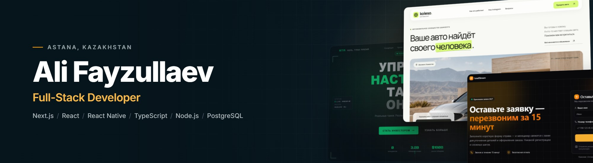
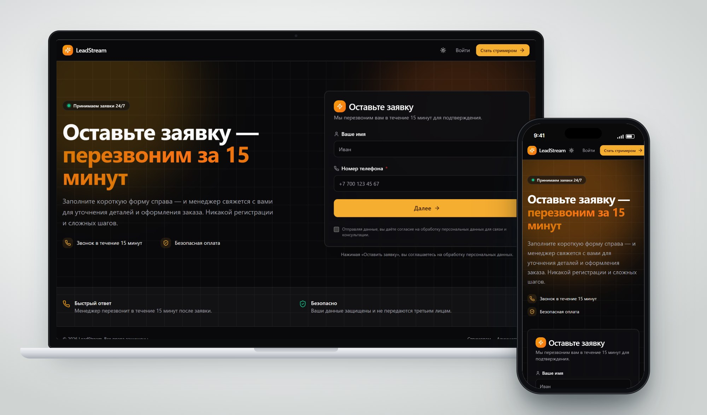
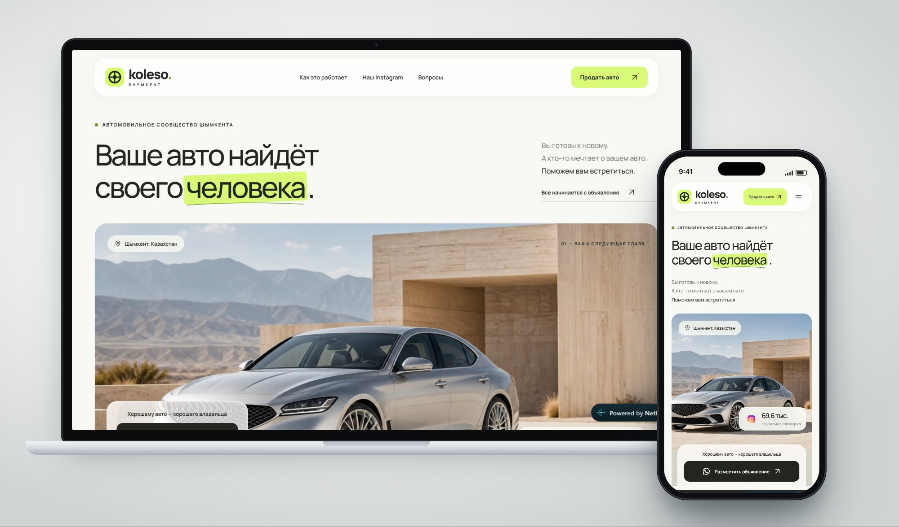
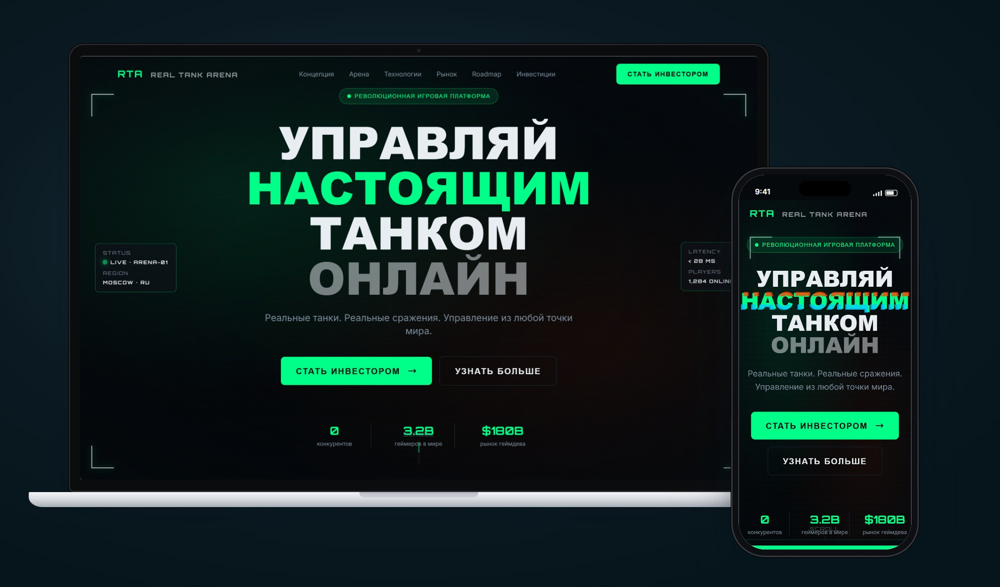

 

I design and build web and mobile products for businesses — from conversion-focused landing pages to CRM systems with dashboards, role-based access and integrations. Over the last two years I have shipped 20+ commercial projects in real estate, finance, automotive, e-commerce and events.

Open to freelance projects and remote roles.

 

  

 

## Stack

 

## Selected work

### LeadStream
Lead-generation platform for TikTok streamers. Every streamer gets a personal referral link and QR code; orders are attributed automatically and shown on an analytics dashboard with charts, tables and Excel export.

`Next.js` `TypeScript` `Supabase` `Tailwind CSS` `Recharts`

[Live site](https://lead-stream-vert.vercel.app) · [Source](https://github.com/Ali-Fayzullaev/LeadStream)

 

### Koleso Shymkent
Website for a car-sales community in Shymkent with a 69K Instagram audience. Clean, editorial design built to turn Instagram traffic into car listings via WhatsApp.

`React` `JavaScript` `Netlify`

[Live site](https://koleso-shymkent.kz) · [Source](https://github.com/Ali-Fayzullaev/koleso-shymkent)

 

### Real Tank Arena
Investor landing page for a platform where players control real tanks online. Bold typographic hero, animated metrics and fully responsive layout.

`HTML` `CSS` `JavaScript`

[Live site](https://real-tank-arena.vercel.app) · [Source](https://github.com/Ali-Fayzullaev/RealTankArena)

 

### More

| Project | Description | Stack |
|---|---|---|
| [Dialogue](https://github.com/Ali-Fayzullaev/app-dialogue) | Cross-platform messenger: chats, media, camera, push notifications | React Native, Expo, Supabase |
| [GoldenCart](https://github.com/Ali-Fayzullaev/GoldenCart) | Web app with dashboard, charts and authentication | Next.js, Supabase, React Query |
| [Al-Quran](https://github.com/Ali-Fayzullaev/Al-Quran) | Quran web app | Next.js, TypeScript |

Most of my commercial work — CRM systems, lead-generation platforms, mobile apps and event registration — lives in private repositories under client agreements. I am happy to walk through it on a call.

 

## Activity

  
  

 

Astana, Kazakhstan · Uzbek, Russian, Kazakh, English
